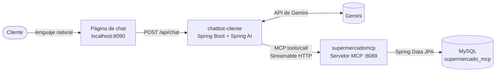
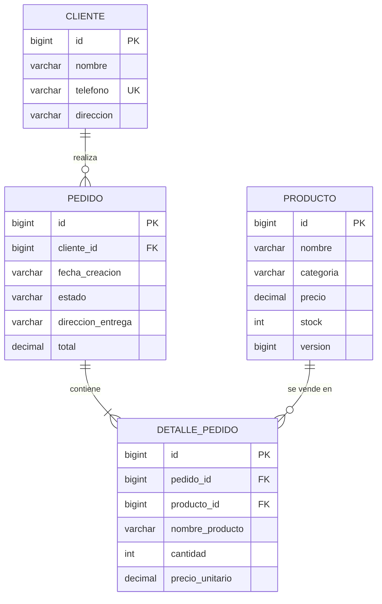
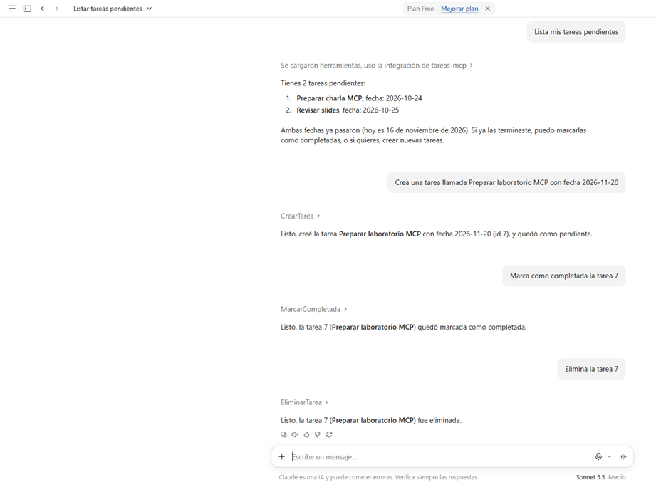
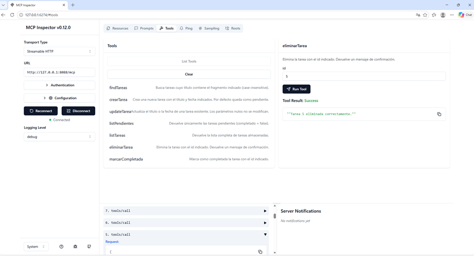
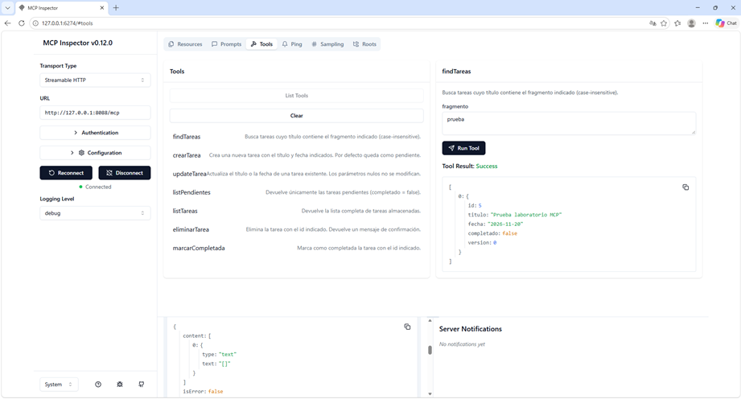
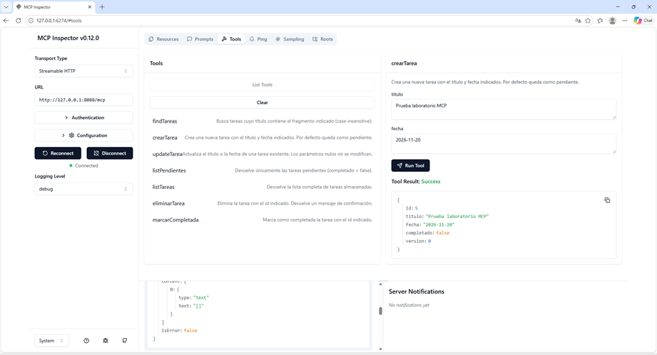
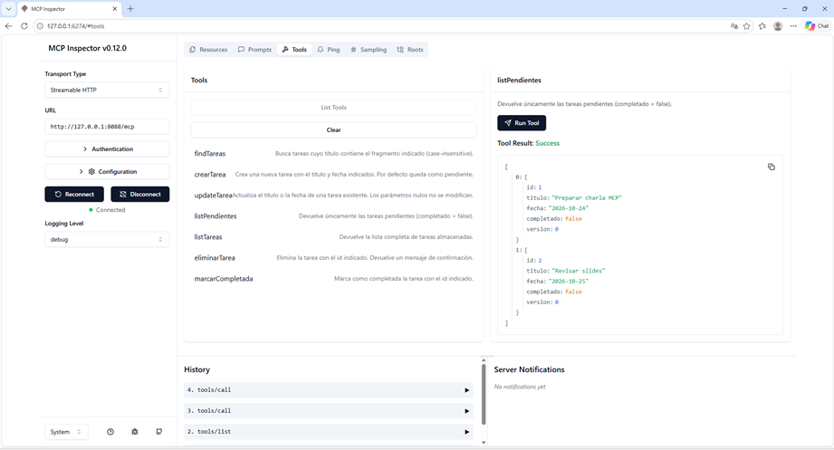
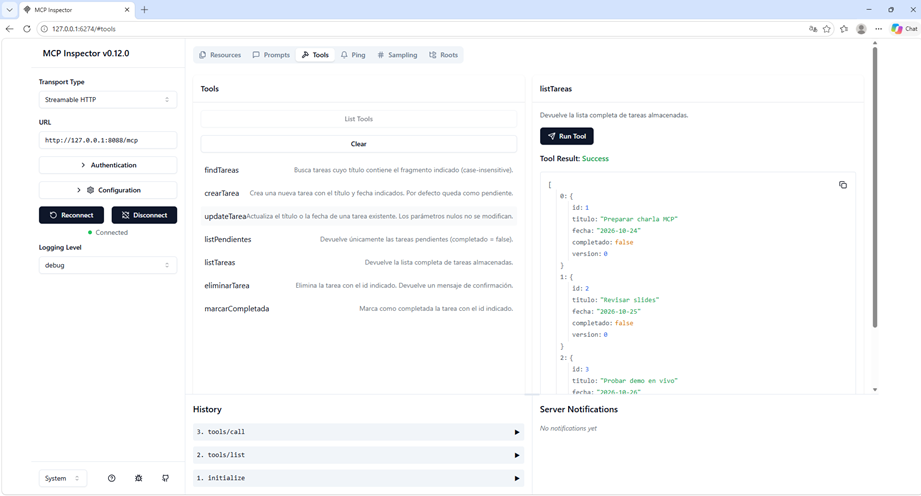
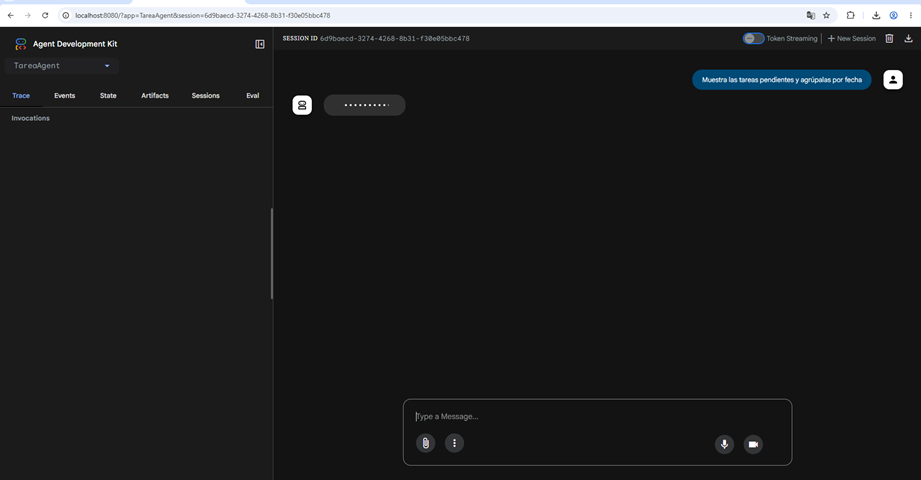
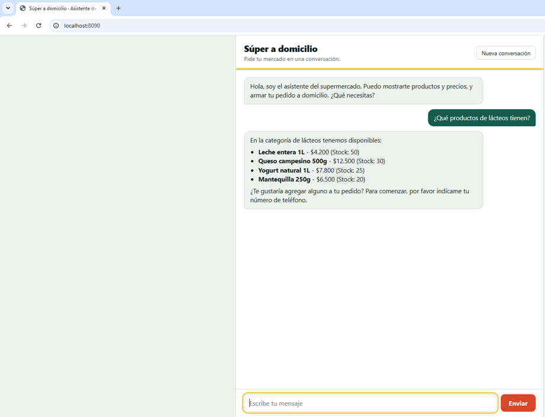

# Súper a domicilio: chatbot con Gemini y servidor MCP

Laboratorio de Arquitectura de Software 2026 · Ingeniería de Sistemas · Universidad de Antioquia
Autor: Jose Fernando Albornoz

Chatbot que permite hacer pedidos de supermercado a domicilio mediante lenguaje natural.
El chatbot (cliente) consume, a través del protocolo **MCP (Model Context Protocol)**, un servidor
que publica operaciones de negocio sobre una base de datos **MySQL**.

---

## 1. Objetivo

Cumplir el ejercicio propuesto en la guía del laboratorio: *realizar un cliente de tipo chatbot e
integrarlo con un servidor MCP que conecte a una base de datos para realizar pedidos de productos
de un supermercado a domicilio*, explicando cada paso de la solución.

Para lograrlo se trabajó en dos etapas:

1. **Parte base de la guía** (`lab3demomcp`): servidor MCP de tareas con Spring Boot + Spring AI + MySQL,
   probado con curl, MCP Inspector y Claude Desktop.
2. **Ejercicio propuesto** (`supermercadomcp` + `chatbot-cliente`): el mismo patrón aplicado a un
   supermercado, con un chatbot propio como cliente MCP.

## 2. Arquitectura



| Componente | Rol en MCP | Descripción |
|---|---|---|
| Página de chat (`index.html`) | Interfaz | Envía los mensajes del usuario al chatbot y muestra las respuestas. |
| `chatbot-cliente` | **Host + cliente MCP** | Contiene la conversación, descubre las herramientas del servidor y las ofrece al modelo. |
| Gemini | Modelo de lenguaje | Decide qué herramienta usar y con qué argumentos, y redacta la respuesta. |
| `supermercadomcp` | **Servidor MCP** | Publica 12 herramientas y las traduce a operaciones Java/JPA. |
| MySQL | Persistencia | Guarda productos, clientes y pedidos. |

### Flujo de un mensaje

1. El usuario escribe, por ejemplo, «agrega 2 leches a mi pedido».
2. El chatbot envía el mensaje, el historial de la sesión y la lista de herramientas MCP al modelo.
3. El modelo elige una herramienta (`agregarProductoAlPedido`) y produce los argumentos.
4. El cliente MCP envía `tools/call` al servidor por Streamable HTTP (JSON-RPC 2.0).
5. Spring AI despacha la llamada al método Java anotado con `@Tool`.
6. El servicio valida las reglas de negocio y consulta o modifica MySQL con JPA.
7. El resultado vuelve al modelo, que lo convierte en una respuesta clara para el usuario.

## 3. Tecnologías

| Tecnología | Versión / uso |
|---|---|
| Java | 21 (compilación con `release 21`) |
| Spring Boot | 3.4.7 |
| Spring AI | 1.1.4 (`spring-ai-starter-mcp-server-webmvc`, `spring-ai-starter-mcp-client`, `spring-ai-starter-model-google-genai`) |
| Base de datos | MySQL 8.x con Spring Data JPA / Hibernate |
| Modelo de IA | Gemini (capa gratuita de Google AI Studio); modelo configurable en `application.properties`, por ejemplo `gemini-3.8-flash` |
| Pruebas del protocolo | curl / PowerShell, MCP Inspector 0.12.0, Claude Desktop con `mcp-remote` |
| Control de versiones | Git + GitKraken |

## 4. Estructura del repositorio

```
laboratorio3/
├─ lab3demomcp/        Parte base de la guía: servidor MCP de tareas (puerto 8088)
├─ supermercadomcp/    Servidor MCP del supermercado (puerto 8089)
├─ chatbot-cliente/    Chatbot con Gemini y cliente MCP (puerto 8090)
├─ docs/               Capturas de pantalla usadas como evidencia
└─ README.md
```

## 5. Modelo de datos



El script `supermercadomcp/src/main/resources/schema.sql` crea la base `supermercado_mcp`, las cuatro
tablas y 26 productos de ejemplo en siete categorías. Los estados de un pedido son
`BORRADOR`, `CONFIRMADO` y `CANCELADO`.

## 6. Herramientas MCP (12)

| Herramienta | Parámetros | Qué hace |
|---|---|---|
| `listarProductos` | — | Lista el catálogo con precio y stock. |
| `buscarProductos` | `texto` | Busca por nombre o categoría, sin distinguir mayúsculas. |
| `consultarStock` | `productoId` | Devuelve el precio y el stock de un producto. |
| `registrarCliente` | `nombre`, `telefono`, `direccion` | Registra un cliente; si el teléfono ya existe, devuelve el existente. |
| `buscarCliente` | `telefono` | Busca un cliente. Si no existe, responde `encontrado = false` (resultado esperado, no un error). |
| `crearPedido` | `clienteId`, `direccionEntrega` (opcional) | Crea un pedido vacío en `BORRADOR`. |
| `agregarProductoAlPedido` | `pedidoId`, `productoId`, `cantidad` | Agrega o suma un producto; valida stock. |
| `quitarProductoDelPedido` | `pedidoId`, `productoId` | Quita un producto de un pedido en `BORRADOR`. |
| `confirmarPedido` | `pedidoId` | Valida el stock, lo descuenta y pasa el pedido a `CONFIRMADO`. |
| `consultarPedido` | `pedidoId` | Devuelve líneas, subtotales, estado y total. |
| `listarPedidosCliente` | `clienteId` | Lista los pedidos de un cliente, del más reciente al más antiguo. |
| `cancelarPedido` | `pedidoId` | Cancela el pedido y, si estaba confirmado, devuelve el stock. |

### Reglas de negocio validadas en el servidor

- La cantidad debe ser un entero mayor que cero.
- No se agrega más cantidad que el stock disponible (se suma lo que ya había en el pedido).
- Solo se pueden modificar pedidos en `BORRADOR`.
- No se confirma un pedido vacío; antes de descontar se valida el stock de **todas** las líneas.
- Cancelar un pedido confirmado devuelve el stock; no se puede cancelar dos veces.
- Las operaciones que modifican datos son transaccionales (`@Transactional`).

## 7. Decisiones de diseño

| Decisión | Motivo |
|---|---|
| **Validar en el servidor**, no en el modelo | El modelo puede equivocarse; las reglas de stock y de estado deben cumplirse siempre. |
| **Confirmación explícita** antes de confirmar o cancelar | Son acciones que cambian datos reales; el *system prompt* obliga a mostrar un resumen y pedir un «sí». |
| **Relaciones por id** (sin relaciones JPA entre entidades) | Evita cargas perezosas y ciclos al serializar a JSON; simplifica las entidades. |
| **DTO (`ResumenPedido`, `LineaPedido`)** como respuesta | El modelo recibe un resumen claro con subtotales y total, no entidades crudas. |
| **Copia del nombre y precio en `detalle_pedido`** | El pedido conserva el precio vigente al momento de la compra aunque el catálogo cambie. |
| **Un resultado esperado no es un error** | Que un cliente no exista es normal en el flujo; `buscarCliente` responde `encontrado = false` en lugar de lanzar una excepción. |
| **Memoria de conversación por sesión** | El chatbot recuerda el cliente y el pedido en curso (ventana de 30 mensajes por `sessionId`). |
| **Streamable HTTP** | Es el transporte vigente de MCP y el que usa la guía; evita el SSE heredado. |
| **Secretos en variables de entorno** | Ninguna clave ni contraseña se escribe en el código ni en el repositorio. |

## 8. Paso a paso de la solución

### Etapa 1. Parte base de la guía (`lab3demomcp`)

1. **Preparar el entorno.** Se verificaron JDK, Maven Wrapper, MySQL, Node.js y Git.
   MySQL no estaba en el PATH de PowerShell, por lo que se usó la ruta completa de `mysql.exe`.
2. **Crear la base de datos** `lab3demomcp` con la tabla `tarea` y tres registros de ejemplo
   (`schema.sql`), y verificar con un `SELECT`.
3. **Crear el servidor MCP** con Spring Boot y Spring AI: entidad `Tarea`, `TareaRepository`,
   `TareaToolsService` con métodos `@Tool` y el `ToolCallbackProvider` en la clase principal.
   La contraseña de MySQL se lee de la variable de entorno `PWD_UDEA`.
4. **Probar el protocolo** con `initialize` por PowerShell y con **MCP Inspector** (transporte
   Streamable HTTP), ejecutando las 7 herramientas y comprobando los cambios en MySQL.
5. **Conectar Claude Desktop** agregando el bloque `mcpServers` a `claude_desktop_config.json` con
   `mcp-remote`, reiniciar la aplicación por completo y verificar el estado *En ejecución* en
   *Configuración → Desarrollador*.

### Etapa 2. Servidor MCP del supermercado (`supermercadomcp`)

6. **Diseñar el dominio:** productos, clientes, pedidos y detalle de pedido (sección 5) y definir las
   12 herramientas (sección 6).
7. **Crear la base de datos** con `schema.sql` (tablas, claves foráneas y datos de ejemplo).
   Se ejecuta con `--default-character-set=utf8mb4` para conservar las tildes.
8. **Configurar `application.properties`:** transporte `STREAMABLE`, endpoint `/mcp`, puerto `8089`
   y conexión a MySQL con la contraseña tomada de `PWD_UDEA`.
9. **Implementar entidades, repositorios y DTO** (`model`, `repository`, `dto`).
10. **Implementar `...ToolsService`** con los métodos `@Tool` y `@ToolParam`, escribiendo descripciones
    claras (el modelo las usa para elegir la herramienta) y validando las reglas de negocio.
11. **Registrar las herramientas** con `MethodToolCallbackProvider` y arrancar el servidor.
    El log debe mostrar `Registered tools: 12`.
12. **Probar con MCP Inspector** el flujo completo: registrar cliente → crear pedido → agregar
    productos → confirmar → cancelar, verificando el stock en MySQL.

### Etapa 3. Chatbot cliente (`chatbot-cliente`)

13. **Crear el proyecto** con `spring-boot-starter-web`, `spring-ai-starter-mcp-client` y
    `spring-ai-starter-model-google-genai`.
14. **Configurar el cliente MCP** para conectarse a `http://localhost:8089` (endpoint `/mcp`) y el
    modelo Gemini. La clave se toma de `GEMINI_API_KEY`.
15. **Construir el `ChatClient`** (`ChatConfig`) con tres piezas: el *system prompt* que define el
    flujo del pedido, la memoria de conversación y las herramientas descubiertas en el servidor MCP.
16. **Exponer `POST /api/chat`** (`ChatController`), que recibe `sessionId` y el mensaje y devuelve la
    respuesta del modelo.
17. **Crear la interfaz web** (`static/index.html`) con el chat, sugerencias rápidas y botón de nueva
    conversación.
18. **Probar el escenario completo** desde el navegador y verificar cada operación en MySQL.

## 9. Cómo ejecutarlo

### Requisitos

JDK 21 (o superior), MySQL 8.x en ejecución, Node.js (solo para Inspector y Claude Desktop) y una
clave gratuita de Gemini creada en `aistudio.google.com/apikey`.

### Ejercicio del supermercado: orden de arranque

1. **Base de datos** (una sola vez; ajustar la ruta del proyecto):
   ```powershell
   & "C:\Program Files\MySQL\MySQL Server 8.0\bin\mysql.exe" -u root -p --default-character-set=utf8mb4 -e "source C:/ruta/laboratorio3/supermercadomcp/src/main/resources/schema.sql"
   ```
2. **Servidor MCP** (ventana de PowerShell 1):
   ```powershell
   cd supermercadomcp
   $env:PWD_UDEA = "SU_CLAVE_LOCAL_DE_MYSQL"
   .\mvnw.cmd spring-boot:run
   ```
   Debe verse `Registered tools: 12` y `Tomcat started on port 8089`.
3. **Chatbot** (ventana de PowerShell 2):
   ```powershell
   cd chatbot-cliente
   $env:GEMINI_API_KEY = "SU_CLAVE_DE_GEMINI"
   .\mvnw.cmd spring-boot:run
   ```
4. Abrir **http://localhost:8090** y conversar con el asistente.

> Las variables de entorno solo viven en la ventana donde se definen. No se guardan claves en el
> repositorio.

### Parte base de la guía: `lab3demomcp` (puerto 8088)

1. **Base de datos** (una sola vez; ajustar la ruta del proyecto):
   ```powershell
   & "C:\Program Files\MySQL\MySQL Server 8.0\bin\mysql.exe" -u root -p --default-character-set=utf8mb4 -e "source C:/ruta/laboratorio3/lab3demomcp/src/main/resources/schema.sql"
   ```
   Crea la base `lab3demomcp` y la tabla `tarea` con tres tareas de ejemplo.
2. **Servidor MCP** (una ventana de PowerShell propia):
   ```powershell
   cd lab3demomcp
   $env:PWD_UDEA = "SU_CLAVE_LOCAL_DE_MYSQL"
   .\mvnw.cmd spring-boot:run
   ```
   Debe verse `Registered tools: 7` y `Tomcat started on port 8088`. Se puede ejecutar al mismo tiempo
   que `supermercadomcp`, porque usan puertos distintos (8088 y 8089); cada ventana necesita su propia
   variable `PWD_UDEA`.
3. **Probar con MCP Inspector:**
   ```powershell
   npx @modelcontextprotocol/inspector@0.12.0
   ```
   En la interfaz se elige el transporte **Streamable HTTP**, la URL `http://127.0.0.1:8088/mcp`, se
   pulsa *Connect* y en *Tools → List Tools* se ejecutan las 7 herramientas
   (`listarTareas`, `listarPendientes`, `buscarTareas`, `crearTarea`, `marcarCompletada`,
   `actualizarTarea`, `eliminarTarea`).
4. **Conectar Claude Desktop** (con el servidor en ejecución). En *Desarrollador → Editar
   configuración* se agrega, al mismo nivel que las demás claves del archivo `claude_desktop_config.json`:
   ```json
   "mcpServers": {
     "tareas-mcp": {
       "command": "npx",
       "args": ["-y", "mcp-remote", "http://localhost:8088/mcp"]
     }
   }
   ```
   Se cierra Claude Desktop por completo desde la bandeja del sistema, se vuelve a abrir y se
   comprueba que `tareas-mcp` aparezca *En ejecución* en *Configuración → Desarrollador*. Luego, en un
   chat nuevo: «Lista mis tareas pendientes». Si se quiere comparar clientes, se puede agregar una
   segunda entrada con el servidor del supermercado (`http://localhost:8089/mcp`).

## 10. Pruebas

| # | Prueba | Acción | Resultado esperado | Evidencia |
|---|---|---|---|---|
| 1 | Conectividad MCP | Arrancar servidor y chatbot | `Registered tools: 12`; el cliente completa `initialize` | `docs/01-arranque.png` |
| 2 | Descubrimiento | Listar herramientas en MCP Inspector | 12 herramientas visibles | `docs/02-inspector.png` |
| 3 | Consulta de catálogo | «¿Qué productos de lácteos tienen?» | Lista con precios y stock reales | `docs/03-lacteos.png` |
| 4 | Cliente nuevo | Indicar un teléfono no registrado, nombre y dirección | Se registra el cliente | `docs/04-cliente.png` |
| 5 | Armar pedido | «Agrega 2 leches y 1 kilo de arroz» | Líneas, subtotales y total correctos | `docs/05-pedido.png` |
| 6 | Confirmación | Pedir resumen y responder «sí, confirmar» | Pedido `CONFIRMADO` y stock descontado en MySQL | `docs/06-confirmado.png` |
| 7 | Stock insuficiente | «500 unidades de leche» | El bot informa el stock disponible y no agrega | `docs/07-stock.png` |
| 8 | Cancelación | «Cancela mi pedido» y confirmar | Pedido `CANCELADO` y stock devuelto | `docs/08-cancelado.png` |
| 9 | Claude Desktop (parte base) | «Lista mis tareas pendientes» | Respuesta con datos reales de `lab3demomcp` | `docs/09-claude-desktop.png` |

Las capturas se guardan en la carpeta `docs/` y se enlazan aquí, por ejemplo:











## 11. Problemas encontrados y soluciones

| Problema | Causa | Solución |
|---|---|---|
| `mysql` no se reconoce en PowerShell | La carpeta `bin` de MySQL no está en el PATH | Usar la ruta completa a `mysql.exe` o agregarla al PATH |
| El script SQL falla con `USE demomcp` | Nombre de base distinto del que crea el script | Usar el mismo nombre en `CREATE DATABASE` y `USE` |
| `Failed to open file ... C:\RUTA\...` | Se pegó el marcador `RUTA` sin reemplazarlo | Escribir la ruta real, con barras `/` |
| `.\mvnw.cmd` no se reconoce | Terminal ubicada fuera de la carpeta del proyecto | Hacer `cd` a la carpeta del proyecto antes de ejecutar |
| Claude Desktop: *Server disconnected* | Servidor Spring detenido o app sin reinicio completo | Arrancar el servidor y cerrar Claude Desktop desde la bandeja del sistema |
| IntelliJ: *VCS root configuration problems* | Mapeo Git duplicado hacia una subcarpeta | Eliminar el mapeo extra en *Directory Mappings* |
| Gemini: `404 ... model is no longer available` | El modelo `gemini-2.5-flash` se retiró para cuentas nuevas | Cambiar a `gemini-3.8-flash` en `application.properties` |
| Gemini: `429 ... Generate content requests per day limit exceeded` | Se agotó la cuota diaria gratuita del modelo (20 solicitudes por día en `gemini-3.8-flash`); cada mensaje con herramientas consume varias | Cambiar a un modelo Flash-Lite, que tiene su propia cuota, o esperar al reinicio diario; vigilar el consumo en `ai.dev/rate-limit` |
| El chat falla al recibir un teléfono nuevo | `buscarCliente` lanzaba una excepción cuando el cliente no existía | Devolver `encontrado = false` en lugar de un error |

## 12. Seguridad y buenas prácticas

- **Secretos fuera del código:** la contraseña de MySQL (`PWD_UDEA`) y la clave de Gemini
  (`GEMINI_API_KEY`) se leen de variables de entorno; nunca se suben al repositorio ni a capturas.
  Si una clave se expone, se revoca y se crea otra.
- **Riesgo de exponer el endpoint MCP sin autenticación:** cualquier cliente que alcance
  `http://host:8089/mcp` podría invocar las herramientas, incluidas las que modifican o cancelan
  pedidos. **Mitigación:** mantener el servidor en `localhost` o en una red privada, agregar
  autenticación y autorización (por ejemplo, Spring Security con tokens), usar TLS y publicar solo las
  herramientas necesarias.
- **Validación en el servidor:** las reglas de stock, estado y cantidad no dependen del modelo.
- **Confirmación humana** antes de operaciones de impacto (confirmar y cancelar pedidos).
- **Datos de prueba:** todo el laboratorio usa datos sintéticos; el plan gratuito de Gemini puede usar
  las conversaciones para mejorar los productos de Google.

## 13. Conclusiones

- Un mismo servidor MCP puede ser consumido por clientes distintos (MCP Inspector, Claude Desktop y un
  chatbot propio) sin cambiar el código del servidor: la lógica de negocio queda en un solo lugar.
- Spring AI permite cambiar de modelo (Claude, Gemini u otro) modificando dependencias y propiedades,
  sin tocar las herramientas.

## 14. Referencias

- Guía de laboratorio: *MCP · Spring Boot · Spring AI · Claude Desktop · Google ADK* (Prof. Diego José Luis Botia V., 2026).
- Model Context Protocol: https://modelcontextprotocol.io/
- Spring AI, servidor MCP: https://docs.spring.io/spring-ai/reference/api/mcp/mcp-server-boot-starter-docs.html
- Spring AI, cliente MCP: https://docs.spring.io/spring-ai/reference/api/mcp/mcp-client-boot-starter-docs.html
- Spring AI, Google GenAI: https://docs.spring.io/spring-ai/reference/api/chat/google-genai-chat.html
- Google AI Studio (clave de API): https://aistudio.google.com/apikey
